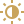
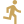
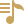
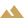
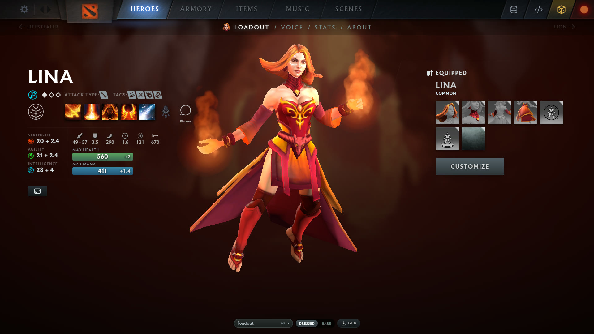
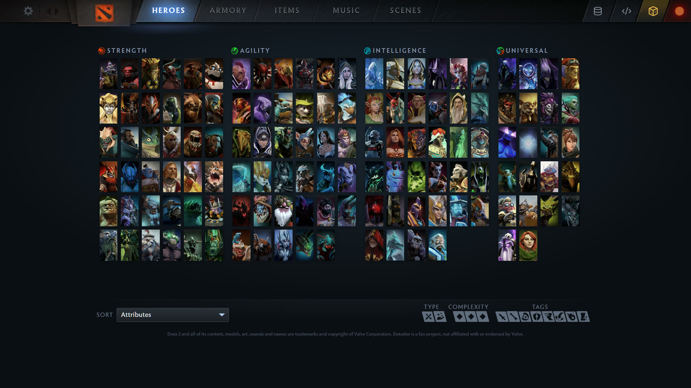
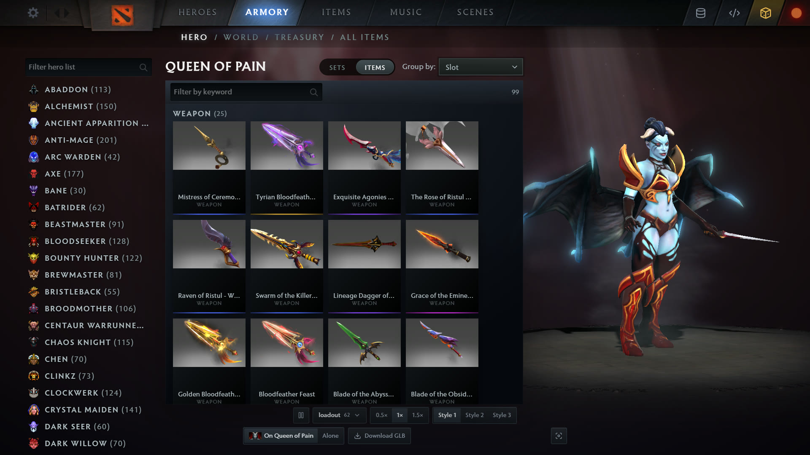
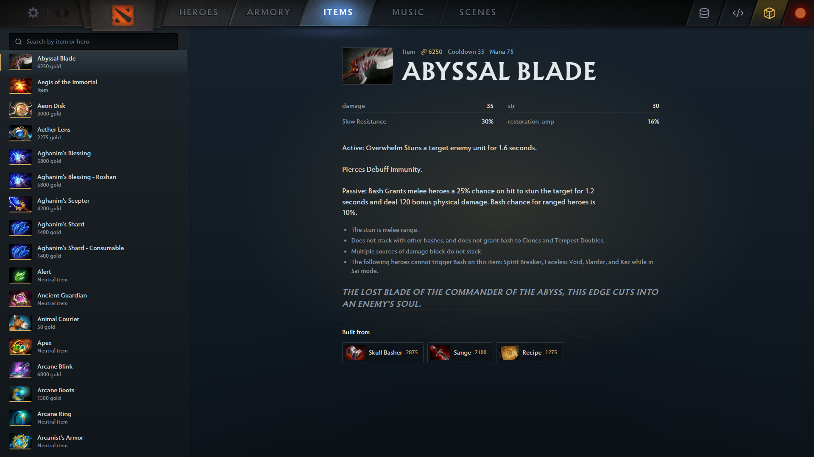
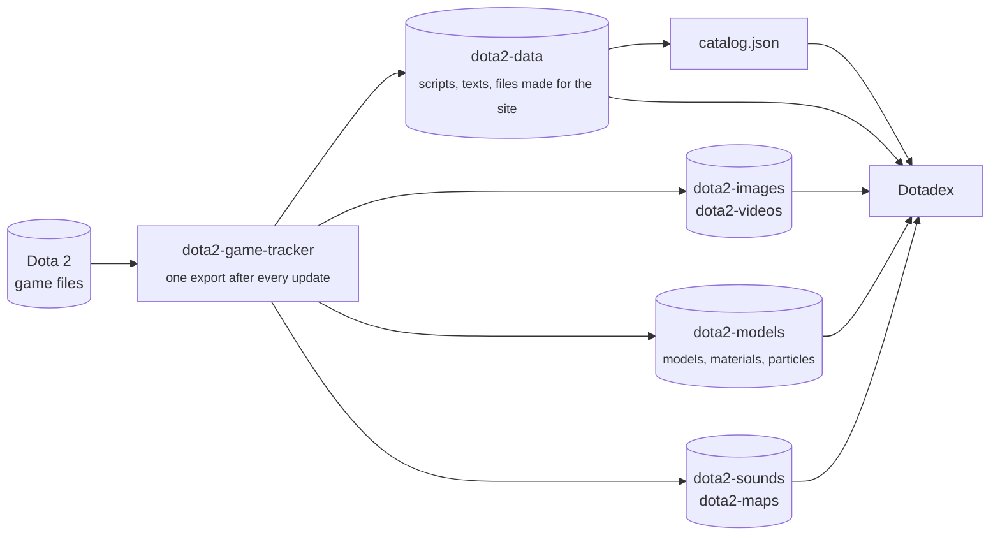

### The complete Dota 2 encyclopedia in 3D

Every hero, cosmetic, courier, ward, treasure and scene of Dota 2, straight from the game files,
shown the way the game shows them.

 

127 heroes · 11,600+ cosmetics · 900+ treasures · 360+ scenes

---

## What's inside

| | | |
|:-:|---|---|
|  | **Heroes** | The hero grid and hero page as in the game: the loadout scene with its lights, camera and pedestal, the hero's stats, abilities, talents and voice lines. |
|  | **Wardrobe** | Dress any hero in any cosmetic or whole set, switch styles, personas and arcanas. Every look has its own link to share. |
|  | **The game's shading** | Models drawn with a port of Dota's hero shader: color warp, rim light, specular and metalness masks, self-illumination, soft shadows, animated materials. |
|  | **Particle effects** | Ambient effects of heroes and items (fire, glows, trails, ropes) run from the game's own particle systems. |
|  | **Animations** | Every animation of a model can be played; models can be downloaded as `.glb`. |
|  | **Armory** | Treasures with their tiers, every courier, ward and other item. |
|  | **Items** | The shop's items with their stats, abilities and recipes. |
|  | **Music and announcers** | Every music pack and announcer pack, to listen to. |
|  | **Scenes** | Dashboard backgrounds and showcase scenes in 3D, with their lights and cameras. |

> [!NOTE]
> Dotadex is made for desktop browsers, like the game's own interface.

## Screenshots

<table>
  <tr>
    <td width="50%"></td>
    <td width="50%"></td>
  </tr>
  <tr>
    <td align="center">The hero grid</td>
    <td align="center">The Armory</td>
  </tr>
</table>

## Links and previews

Every page has a plain address you can share, such as
[`/Dotadex/hero/lina`](https://s1nuxoff.github.io/Dotadex/hero/lina) or
[`/Dotadex/item/4517`](https://s1nuxoff.github.io/Dotadex/item/4517). The look you put together stays in
the link (`/hero/pudge?head=4007.1`). Link previews in messengers and search engines show the page's
own title, description and picture.

## How it works

Nothing on the site is drawn or tuned by hand: everything comes from the game files, through a chain of
trackers that follow every Dota 2 update.

- **[dota2-game-tracker](https://github.com/S1nuxoff/dota2-game-tracker)** exports the game to Hugging Face
  datasets after every update: [dota2-data](https://huggingface.co/datasets/Sqls1/dota2-data) (every script
  and localization as JSON, and under `dotadex/` the files made for this site),
  [dota2-images](https://huggingface.co/datasets/Sqls1/dota2-images) and
  [dota2-videos](https://huggingface.co/datasets/Sqls1/dota2-videos) (the interface's pictures and videos as
  the game keeps them), [dota2-models](https://huggingface.co/datasets/Sqls1/dota2-models) (models with
  their materials, textures, animations and particle systems),
  [dota2-sounds](https://huggingface.co/datasets/Sqls1/dota2-sounds) and
  [dota2-maps](https://huggingface.co/datasets/Sqls1/dota2-maps). Its `DATA.md` maps every file.
- Market prices come from [dota2-price-tacker](https://github.com/S1nuxoff/dota2-price-tacker).
- The site is rebuilt on every push and every six hours, so new heroes and items show up on their own.

## Checked against the game, pixel by pixel

The shading is not eyeballed from screenshots. Dotadex runs the game's own hero shader, ported
instruction by instruction from its compiled code, and its lighting, shadows and particle defaults are
taken from what the game itself does:

- **Frame captures of the real game.** The hero page and the Armory are captured with
  [RenderDoc](https://renderdoc.org/), and the constants the game hands its shaders (the light, the
  shadow's projection, every material parameter) are compared with the site's, value for value.
- **Pixel traces.** A single pixel of a hero is stepped through the game's shader in RenderDoc, and the
  same pixel through the site's: every intermediate term (N·L, the highlight, the fresnel, the warp) is
  printed side by side until the two agree.
- **The engine's own data.** Particle operators take their defaults from the engine's class schema, and
  the hero page's light, camera and shadow follow the game's code and portrait data, not a guess.

## Support

Dotadex is free and made in spare time. If you enjoy it, you can
[buy me a coffee on Ko-fi](https://ko-fi.com/s1nuxoff).

---

A fan project, not affiliated with or endorsed by Valve. Dota 2 and its content are trademarks and
property of Valve Corporation.
